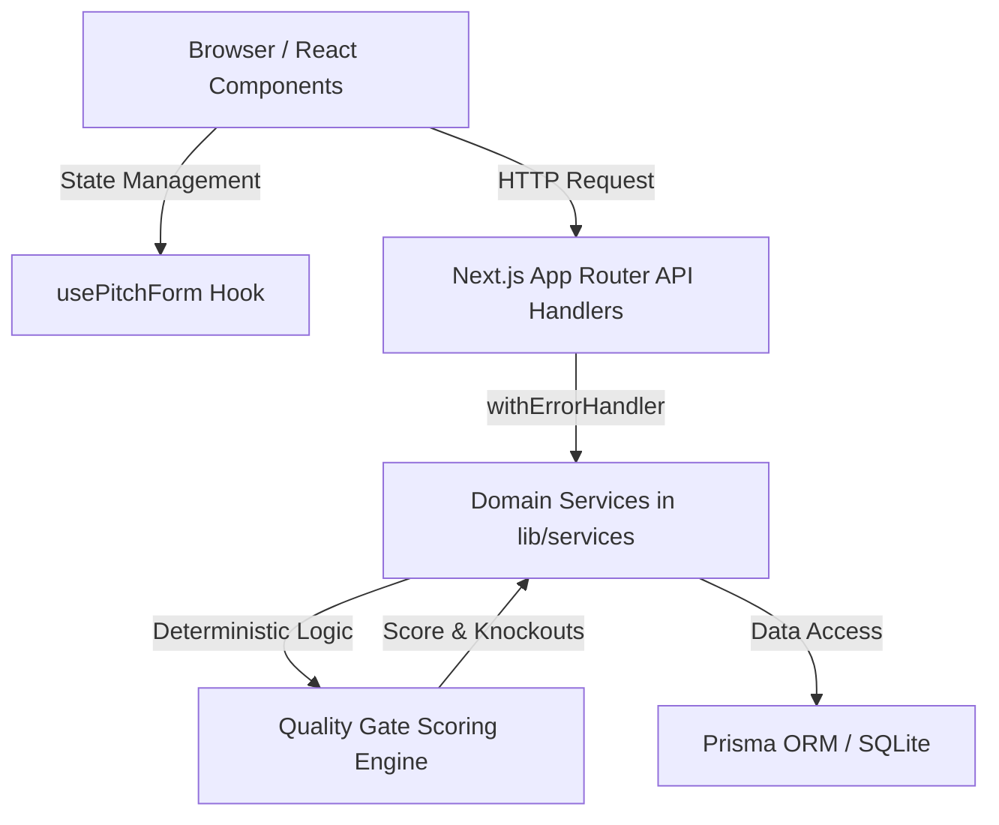

# SkillProof Architecture & Technical Reference

SkillProof is a deterministic, explainable quality-gating platform designed to connect verified student solvers with education organizations (coaching centers, tuition providers, college departments). It eliminates application spam and noise through a pure, rule-based Two-Tier Quality Gate with zero external LLM dependencies.

---

## 1. Directory Structure

```text
c:\GITDESK\SKILLPROOF\
├── app/                              # Next.js 14 App Router (Presentation & Routing)
│   ├── admin/calibrate/              # Gate Calibration Test Suite Dashboard (VAL-1 to VAL-6)
│   ├── api/                          # HTTP Route Handlers (Thin HTTP controllers)
│   │   ├── calibrate/                # GET: Calibration test suite results
│   │   ├── organizations/            # GET: Organization listing
│   │   ├── org/problems/[id]/proposals/ # GET: Vetted inbox (passed proposals only)
│   │   ├── problems/                 # GET (list with filters), POST (create friction challenge)
│   │   │   └── [id]/                 # GET: Problem detail & pitch stats
│   │   │       └── pitch/            # POST: Pitch submission & gate evaluation
│   │   ├── proposals/[id]/           # GET: Standardized proposal PDF view
│   │   └── users/                    # GET: Solvers by credibility
│   ├── org/
│   │   ├── problems/new/             # Poster problem creation wizard
│   │   ├── problems/[id]/proposals/  # Vetted proposal inbox
│   │   └── proposals/[id]/           # Standardized printable proposal document
│   ├── problems/                     # Public challenges catalog
│   │   └── [id]/pitch/               # 5-step interactive pitch wizard
│   │       └── result/               # Instant gate score breakdown & feedback
│   ├── globals.css                   # Tailwind base, components, and print rules
│   ├── layout.tsx                    # Root layout with Navbar and brand footer
│   └── page.tsx                      # Landing page with stats & featured challenges
│
├── components/                       # Reusable UI Components
│   ├── KnockoutCard.tsx              # Comic-styled Tier 1 knockout explanation badge
│   ├── Navbar.tsx                    # Responsive brand navigation with solver stats
│   ├── ProposalCard.tsx              # Standardized vetted proposal preview card
│   ├── ScoreMeter.tsx                # Dimensional breakdown & visual score meters
│   ├── SlideButton.tsx               # Interactive slide-to-action button
│   └── Stepper.tsx                   # Multi-step progress indicator
│
├── lib/                              # Core Domain & Infrastructure
│   ├── api/                          # API utilities & HTTP contracts
│   │   ├── errors.ts                 # AppError, ValidationError, NotFoundError hierarchy
│   │   └── response.ts               # successResponse, errorResponse, withErrorHandler
│   ├── config/                       # Configuration & Environment
│   │   └── env.ts                    # Strongly typed env vars & runtime defaults
│   ├── db.ts                         # Prisma client singleton (SQLite)
│   ├── hooks/                        # Custom React Hooks
│   │   └── usePitchForm.ts           # Unified form state, localStorage draft, gate preview
│   ├── scoring/                      # Deterministic Quality Gate
│   │   ├── calibrationData.ts        # VAL-1 to VAL-6 test vectors (10 test cases)
│   │   └── engine.ts                 # Pure TypeScript 2-tier scoring engine
│   └── services/                     # Business Logic Layer (Decoupled from UI & Routes)
│       ├── organization.service.ts   # Organization queries & provisioning
│       ├── pitch.service.ts          # Submission, gate execution, and vetted inboxes
│       ├── problem.service.ts        # Friction problem catalog & platform metrics
│       └── user.service.ts           # Solver management & credibility rewards
│
├── prisma/
│   ├── schema.prisma                 # SQLite schema (User, Organization, Problem, Pitch)
│   ├── dev.db                        # Local database
│   └── seed.ts                       # Realistic seed data
│
├── scripts/
│   └── calibrate.ts                  # CLI runner for VAL-1 to VAL-6 assertions
│
├── types/
│   └── index.ts                      # Shared TypeScript contracts and domain models
│
├── .env.example                      # Environment configuration template
├── package.json                      # Scripts & dependencies
└── tailwind.config.ts                # Brand color palettes and typography
```

---

## 2. Layered Architecture & Separation of Concerns

SkillProof follows a clean 3-tier decoupled architecture:



### A. Presentation Layer (`app/` & `components/`)
- Purely responsible for layout, typography, UI interactivity, and rendering.
- State is managed declaratively via typed custom hooks (`usePitchForm`).
- Server components query domain services directly without redundant internal HTTP calls.

### B. Business Logic & Domain Services (`lib/services/`)
- Completely decoupled from Next.js route handlers and UI components.
- Handles validations, multi-entity transactions, credibility point adjustments, JSON parsing, and quality gate triggers.
- Can be tested in isolation or invoked from background jobs and CLI scripts.

### C. Pure Deterministic Quality Engine (`lib/scoring/`)
- Stateless and synchronous pure TypeScript functions (`evaluatePitch`, `checkKnockoutCriteria`).
- Zero LLM API calls, zero hallucination risk, predictable runtime ($<2\text{ms}$).
- Shared directly by the backend evaluation pipeline and the frontend live validation health indicator.

---

## 3. Two-Tier Quality Gate Design

### Tier 1: Binary Knockout Criteria (Immediate Disqualification)
A submission is immediately failed ($0.0/10$) if any of the following fail:
1. **Pricing Check (`hasPricing`)**: Explicit currency symbols ($₹$, $\$$, $€$, $£$, Rs, INR) or concrete figures.
2. **Alternatives Check (`normalizeAlternatives`)**: Minimum 2 distinct alternative approaches evaluated with pros, cons, and rejection reasons.
3. **Minimum Effort Check (`calculateTotalLength`)**: Pitch character count across all 5 steps must exceed 200 characters.

### Tier 2: 6-Dimension Calibrated Scoring (Threshold = 6.0 / 10.0)
Pitches that survive Tier 1 are scored across 6 dimensions calibrated against PRD VAL-1 through VAL-6:
- **Problem Diagnosis** (Weight: 2.0 / 10.0)
- **Solution Actionability & Architecture** (Weight: 2.0 / 10.0)
- **Alternatives Depth & Trade-offs** (Weight: 1.5 / 10.0)
- **Pricing Transparency & Cost Breakdown** (Weight: 1.5 / 10.0)
- **Solver Proof & Verifiable Credentials** (Weight: 1.5 / 10.0)
- **Operational Constraints & Feasibility Risks** (Weight: 1.5 / 10.0)

---

## 4. Scalable API Contract & Error Handling

All route handlers are wrapped with `withErrorHandler`:
- **Success Format**: Standard HTTP status (200, 201) with clean typed JSON payload.
- **Error Format**:
  ```json
  {
    "error": "Error description message",
    "code": "VALIDATION_ERROR | NOT_FOUND | INTERNAL_SERVER_ERROR",
    "details": null
  }
  ```

---

## 5. Development Workflows

```bash
# 1. Start development server
npm run dev

# 2. Run deterministic gate calibration test suite
npm run calibrate

# 3. Seed demo data
npm run db:seed

# 4. Typecheck codebase
npx tsc --noEmit
```
